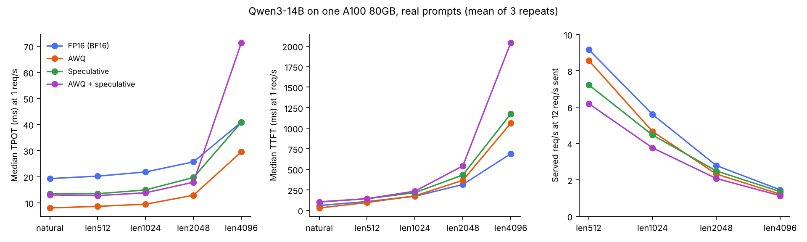

# Efficient LLM Serving on a Single GPU

CS5903 Distributed AI Training, Fall 2026. Group 4, Project 24.
Vishank Singh (AI23BTECH11032), Anup Chavan (CS23BTECH11005).

A benchmark study of four serving optimisations in vLLM on one GPU: AWQ weight quantisation, speculative decoding with a draft model, prefix caching, and FP8 KV cache. It measures what each does to latency and throughput, alone and combined, across request rates and prompt lengths.

- Report: [`docs/Project_Report.pdf`](docs/Project_Report.pdf)
- Decision records: [`docs/Architecture_Decision_Records.md`](docs/Architecture_Decision_Records.md)
- Presentation: [`docs/Final_Presentation.pdf`](docs/Final_Presentation.pdf)
- Demo walkthrough: [`docs/Demo_Script.md`](docs/Demo_Script.md)

## Status

| Part | State |
|---|---|
| Benchmark harness, run checks, analysis | Working. Every table regenerates from the raw result files. |
| AWQ, speculative decoding, AWQ + speculative, on Qwen3-14B with real prompts | Measured, 3 repeats |
| Prefix caching off against on | Measured for FP16 and AWQ. Not measured together with speculative decoding. |
| FP8 KV cache | Not measured. The FP8 server did not serve on the lab GPU, and it was not run on the 14B model. |
| Output quality of the AWQ model | Not measured |
| Batching, prefill scheduling, parallelism strategy | Left at vLLM defaults, single GPU. Not studied. |

## Main results (Qwen3-14B, one A100 80 GB, real prompts)

| Situation | Best configuration | Evidence |
|---|---|---|
| Prompts up to about 1,000 tokens, load well below capacity | AWQ | Median TPOT 9.5 ms against 21.8 ms for FP16 at 1,024 tokens and 1 request/s (2.3×) |
| Prompts of 2,000 tokens or more, or load near capacity | FP16 | AWQ serves 17% fewer requests/s at 1,024–4,096 tokens (4.66 against 5.60 at 1,024) |
| Requests share a system prompt | Prefix caching on | With AWQ at 12 requests/s: TTFT 510 → 65 ms, TPOT 91 → 17 ms |
| Speculative decoding (0.6B draft, 5 tokens) | Not worth enabling | 1.3–1.5× lower TPOT than FP16 at 1 request/s, but slower than AWQ alone, lower capacity, and never higher goodput |

Capacity is set by prompt processing: FP16 prefills about 5.5–5.6k prompt tokens/s at every prompt length from 1,024 to 4,096. Full results, with spread across repeats and caveats: [`evaluation/03_qwen3-14b_sharegpt/README.md`](evaluation/03_qwen3-14b_sharegpt/README.md).



## How it works

```
prepare_prompts.py ──> prompts/*.jsonl ──┐
                                         v
run_sweep.sh ──> vllm serve (one configuration) <── vllm bench serve (one rate, one workload)
                                         │
                                         v
                       data/raw/<config>_<workload>_rate<R>_rep<N>.json
                                         │
        summarise.py (checks) ──> summary.csv ──> analyse.py ──> results/tables.md, figures/
        goodput.py ──> goodput.csv ──────────────────┘
```

For each configuration the sweep script starts a vLLM server with one set of flags, sends 200 requests at each request rate and workload with vLLM's load generator, saves one JSON per run with per-request timings, and stops the server. The analysis recomputes each run's medians from the per-request data, flags any run with failed requests or wrong output lengths, and builds the tables from runs that pass.

We did not write a serving engine. Our code is the harness, the prompt builder, the checks and the analysis.

## Layout

```
evaluation/01_qwen2.5-3b_1024tok/   study 1: 201 runs, Qwen2.5-3B, one prompt length
evaluation/02_qwen2.5-3b_lengths/   study 2: 864 runs, Qwen2.5-3B, six prompt lengths
evaluation/03_qwen3-14b_sharegpt/   study 3: 504 runs, Qwen3-14B, real prompts (final results)
tests/                              pytest: regeneration, run checks, every quoted number
docs/                               report, decision records, presentation, demo script, progress documents
```

Each study folder has `scripts/` (benchmark), `data/raw/` (one result file per run), `analysis/`, generated tables and its own README.

## Setup and tests (no GPU needed)

Python 3.11 or newer.

```bash
git clone https://github.com/anupchavan/efficient-llm-serving
cd efficient-llm-serving
pip install -r requirements.txt
pytest
```

Expected: `27 passed` in under a minute. The tests rebuild every summary and table from the raw files and compare them byte-for-byte with the committed ones, check each rule used to exclude runs, and check the headline numbers quoted in the report against the data.

To regenerate tables and figures by hand, see [`evaluation/README.md`](evaluation/README.md).

Example input and output: `evaluation/03_qwen3-14b_sharegpt/data/raw/awq_len1024_rate1_rep1.json.gz` is one run (200 requests, AWQ, 1,024-token prompts, 1 request/s). Its row in `data/summary.csv` reads `median_tpot_ms` 9.47, `median_ttft_ms` 179.7, `completed` 200, `checks` ok.

## Running the benchmarks (GPU needed)

Study 3 needs one GPU with 80 GB of memory (it was run on an A100 SXM4 80 GB), CUDA 12.8 or newer, and about 50 GB of disk. No account or API key is needed: the three models (Qwen/Qwen3-14B, Qwen/Qwen3-14B-AWQ, Qwen/Qwen3-0.6B), ShareGPT and the role-prompt list are public downloads. The lab's 24 GB GPU cannot hold the 14B model, so rerunning study 3 means renting an 80 GB GPU for about 15 hours (under 1 hour for the pilot).

```bash
cd evaluation/03_qwen3-14b_sharegpt
./scripts/setup_host.sh            # vLLM 0.30.0, models, sources, prompt files
PILOT=1 ./scripts/run_sweep.sh     # end-to-end check: 16 runs -> data/pilot/
python3 analysis/summarise.py data/pilot    # expect "16 runs, 0 flagged"
./scripts/run_sweep.sh             # full sweep: 504 runs -> data/raw/
```

The committed `data/pilot/` is the output of this pilot from 5 November 2026.

Operation:

- The sweep can be stopped with Ctrl-C and restarted; finished runs are skipped.
- To stop a server left running: `pkill -f "vllm serve"`. To start over, delete `data/raw/`.
- Logs: `logs/server_<config>.log` (vLLM) and `logs/bench_<config>.log` (load generator).
- If a server does not come up within 30 minutes or its process exits, the script stops and names the log. If any run fails, the sweep stops at that run.
- `pip install vllm` without `[bench]` makes every benchmark request fail; `setup_host.sh` installs `vllm[bench]==0.30.0`.
- The server binds port 8000. If another process is already listening there, the health check passes against that process; make sure the port is free.

Environment variables are optional and listed in [`.env.example`](.env.example).

## Limitations

- One engine (vLLM 0.30.0), one GPU per study, one draft model and draft length.
- The 3B and 14B studies differ in model family, GPU, prompts and caching, so they do not isolate the effect of model size.
- The reason AWQ prefills more slowly than FP16 was not profiled.
- 200 requests per run and a coarse rate grid (1, 2, 3, 4, 6, 8, 12 requests/s): capacity for short prompts is only bounded from below, and goodput is known only at grid points.

The report lists these in full, with the open tasks.
