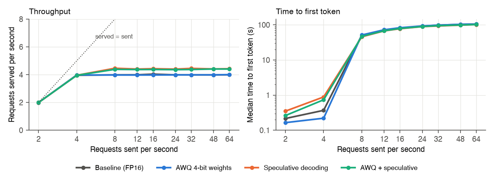
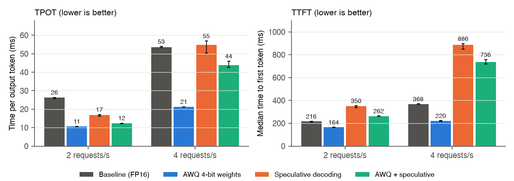

# Efficient LLM Serving on a Single GPU

CS5903 Distributed AI Training, Fall 2026. Group 4, Project 24.
Vishank Singh (AI23BTECH11032), Anup Chavan (CS23BTECH11005).

We measure how AWQ weight quantisation and speculative decoding change the latency and throughput of Qwen2.5-3B-Instruct served with vLLM on one 24 GB GPU, alone and combined, from light load to overload.

- Report: [`report/report.pdf`](report/report.pdf)
- Slides: [`slides/slides.pdf`](slides/slides.pdf)

## Results



- The GPU serves at most 4.0–4.4 requests/s with 1,024-token prompts. Above that, requests queue, and the median time to first token (TTFT) goes from under 1 s to 50–106 s. None of the techniques moves this limit much.



| Configuration | 2 requests/s | 4 requests/s | Overloaded (16–64/s) |
|---|---|---|---|
| Baseline (FP16, vLLM defaults) | 1.00× | 1.00× | 4.0 requests/s |
| AWQ | 2.47× | 2.52× | 4.0 |
| Speculative decoding | 1.56× | 0.98× | 4.4 |
| AWQ + speculative decoding | 2.11× | 1.22× | 4.4 |

The table shows speed-up in time per output token (TPOT) over the baseline. The last column shows requests served per second.

- Below the throughput limit, AWQ lowers TPOT about 2.5 times, because decode is limited by memory bandwidth and AWQ weights are about a third of the size.
- Speculative decoding helps at 2 requests/s and stops paying by 4 requests/s. It also raises TTFT, because the draft model runs prefill too.
- AWQ alone beats AWQ with speculative decoding. With AWQ the 3B model pass is already cheap, so the 5 draft steps per round cost more than they save (about 55% of drafted tokens are accepted).

## Setup

| | |
|---|---|
| GPU | NVIDIA RTX PRO 4000 Blackwell, 24 GB |
| Server | vLLM 0.30, `--gpu-memory-utilization 0.95`, `--max-model-len 8192` |
| Models | Qwen2.5-3B-Instruct or Qwen2.5-3B-Instruct-AWQ; Qwen2.5-0.5B as draft (5 tokens) |
| Load | `vllm bench serve`, 1,000 requests per run, 2–64 requests/s |
| Workload | 1,024 prompt tokens, 128 output tokens |
| Repeats | Up to 6 per setting, 201 runs |

## Layout

```
scripts/run_benchmarks.sh   start vLLM per configuration and run the load sweep
data/raw/                   one vllm bench JSON per run: <config>_rate<R>_rep<N>.json
data/summary.csv            one row per run with the main metrics
analysis/summarise.py       data/raw -> data/summary.csv
analysis/plots.py           summary.csv -> figures/, and prints the numbers used in the report
figures/                    plots (PDF for LaTeX, PNG for this page)
report/                     report.tex and report.pdf
slides/                     slides.tex and slides.pdf
```

Configurations: `baseline`, `awq`, `spec` (speculative decoding), `awq_spec`.

## Reproduce

Benchmarks (needs a CUDA GPU and vLLM 0.30; about 4–5 hours per configuration):

```bash
pip install vllm==0.30.0
./scripts/run_benchmarks.sh
```

Analysis and figures (any machine):

```bash
pip install matplotlib
python3 analysis/summarise.py
python3 analysis/plots.py
```

Report and slides:

```bash
cd report && pdflatex report.tex && pdflatex report.tex
cd ../slides && pdflatex slides.tex && pdflatex slides.tex
```

## Next

Prompt lengths from 512 to 6,144, prefix caching with shared-prefix prompts, FP8 KV cache, an AWQ output-quality check, and goodput at a latency target (TTFT under 1 s, TPOT under 50 ms).
