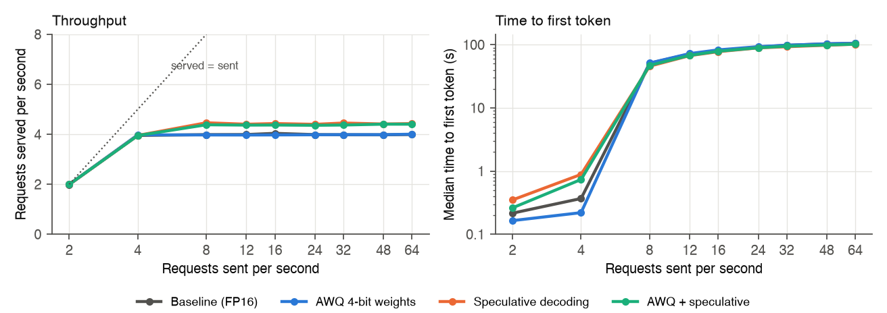
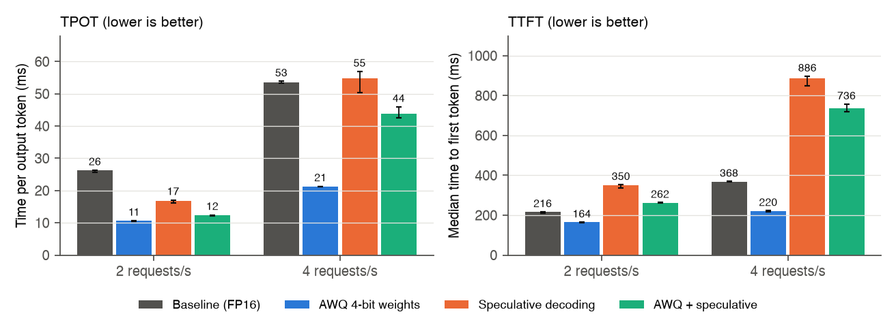

# Study 1: Qwen2.5-3B, 1,024-token random prompts

201 runs on the lab GPU, 7–10 October 2026. This was the first working version of the benchmark pipeline. Its results are superseded by study 3; it is kept because the week-6 report and slides of 16 October were written from it (`docs/progress/`).

| | |
|---|---|
| GPU | NVIDIA RTX PRO 4000 Blackwell, 24 GB |
| Server | vLLM 0.30, `--gpu-memory-utilization 0.95 --max-model-len 8192`, other settings default |
| Models | Qwen2.5-3B-Instruct, Qwen2.5-3B-Instruct-AWQ, Qwen2.5-0.5B as draft (5 tokens) |
| Load | `vllm bench serve --dataset-name random`, 1,000 requests per run, 2–64 requests/s |
| Workload | 1,024 random prompt tokens, 128 output tokens |
| Configurations | `baseline` (FP16), `awq`, `spec`, `awq_spec` |

## Results

TPOT here is the mean over requests in a run (`mean_tpot_ms`), averaged over repeats. Studies 2 and 3 use the median.

| Configuration | TPOT at 2 req/s | TPOT at 4 req/s | Served at 16–64 req/s sent |
|---|---|---|---|
| Baseline (FP16) | 26.1 ms | 53.6 ms | 3.99 req/s |
| AWQ | 10.6 ms (2.46×) | 21.2 ms (2.52×) | 3.99 |
| Speculative | 16.7 ms (1.56×) | 54.4 ms (0.98×) | 4.42 |
| AWQ + speculative | 12.3 ms (2.11×) | 44.1 ms (1.21×) | 4.38 |

Speculative decoding accepted 52–58% of drafted tokens.




## Limits of this study

- One prompt length. The sweep was meant to cover several lengths, but every run used 1,024 tokens.
- Random-token prompts share no prefix, so prefix caching (on by default in vLLM) had nothing to reuse and was not measured.
- Repeats are uneven: 6 per setting for `awq` and `awq_spec`; `baseline` has 2 at 16, 32 and 64 requests/s; `spec` has 4 at 2 and 5 at 4 requests/s. 8 of about 201,000 requests failed.
- Per-request timings were not saved, so medians cannot be recomputed and goodput cannot be computed per request.
- FP8 KV-cache servers were also started in this experiment and did not come up. No FP8 result exists.

## Reproduce

```bash
python3 analysis/summarise.py   # data/raw -> data/summary.csv
python3 analysis/plots.py       # summary.csv -> figures/, prints the numbers above
./scripts/run_benchmarks.sh     # needs the GPU and vLLM 0.30; 4-5 hours per configuration
```
