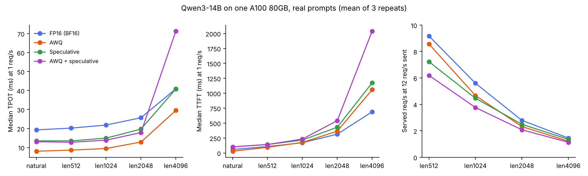
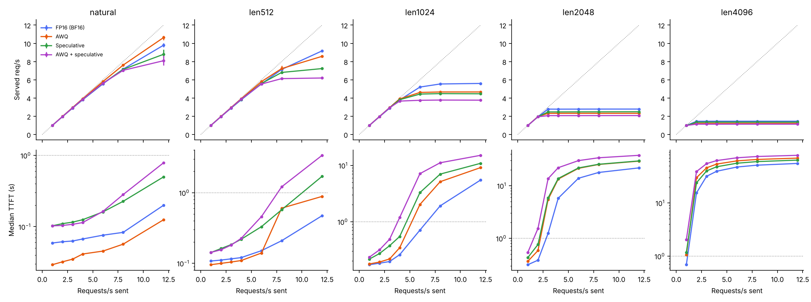
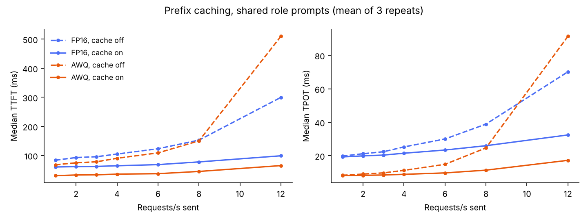

# Qwen3-14B with real prompts: results

Sweep finished 2026-11-09. 504 runs on one RunPod A100 SXM4 80GB, all of which passed the checks in `analysis/summarise.py` (200 of 200 requests, 128 output tokens each, recomputed medians match vLLM's). Every number below is the mean of 3 repeats, each repeat with a different prompt sample. All tables come from `analysis/analyse.py` (full version in [`results/tables.md`](results/tables.md)), and goodput comes from `analysis/goodput.py`, run on the per-request data.

## Setup

| | |
|---|---|
| GPU | A100 SXM4 80GB (RunPod Secure Cloud) |
| Server | vLLM 0.30.0, `--gpu-memory-utilization 0.95 --max-model-len 8192`, prefix caching off unless stated |
| FP16 | Qwen3-14B in BF16 (we keep calling it FP16, as in the progress presentation) |
| AWQ | Qwen/Qwen3-14B-AWQ, which vLLM ran with its Marlin kernel |
| Speculative | Qwen3-0.6B draft, 5 tokens per step |
| Load | `vllm bench serve`, 200 requests per run, Poisson arrivals at 1, 2, 3, 4, 6, 8 and 12 requests/s |
| Output | 128 tokens (`--ignore-eos`), temperature 0.7, top-p 0.8, top-k 20, thinking off |

Prompts are first user turns from ShareGPT, deduplicated, with the chat template applied:

| Workload | Prompts available | Median prompt tokens | Notes |
|---|---|---|---|
| natural | 46,261 | 44 | real length mix, up to 4,096 tokens; mostly short chat messages |
| len512 / len1024 / len2048 / len4096 | 1,643 / 1,497 / 939 / 215 | 496 / 1,008 / 1,973 / 3,629 | real prompts within ±20% of the target length |
| prefix | 43,178 | 298 | one of 32 role prompts as the system message, then a user prompt up to 1,024 tokens; about 80% of each prompt is the shared role prompt (median) |

KV-cache room that vLLM reported at start-up: FP16 306,224 tokens, AWQ 424,432, speculative 171,536, AWQ + speculative 241,200.

## 1. Light load: AWQ is fastest, and speculative decoding does not help on top of it

Median time per output token (TPOT) at 1 request/s, with the speed-up over FP16:

| Workload | FP16 | AWQ | Speculative | AWQ + speculative |
|---|---|---|---|---|
| natural | 19.3 ms | 8.0 ms (2.41×) | 13.5 ms (1.43×) | 13.0 ms (1.48×) |
| len512 | 20.2 ms | 8.6 ms (2.34×) | 13.5 ms (1.50×) | 12.8 ms (1.58×) |
| len1024 | 21.8 ms | 9.5 ms (2.31×) | 14.9 ms (1.46×) | 13.8 ms (1.58×) |
| len2048 | 25.7 ms | 12.9 ms (1.99×) | 19.7 ms (1.30×) | 17.9 ms (1.44×) |
| len4096 | 40.9 ms | 29.5 ms (1.39×)* | 40.8 ms (1.00×) | 71.3 ms (0.57×)* |

\* At len4096, 1 request/s is already 83% (AWQ) and 88% (AWQ + speculative) of what that setup can serve, so those two cells are not light load.

- AWQ cuts TPOT about 2.3–2.4× for prompts up to about 1,000 tokens. Decode is limited by memory bandwidth, and AWQ weights are about a third of the size.
- Speculative decoding gives 1.3–1.5× over FP16 at light load. Only 35–38% of drafted tokens are accepted, about 2.7–2.9 tokens per step (section 6). It also raises TTFT, from 59 to 103 ms on natural prompts and from 172 to 216 ms at len1024, because the draft model also runs prefill.
- AWQ + speculative is slower than AWQ alone at every length (12.8 vs 8.6 ms at len512, 13.8 vs 9.5 ms at len1024). The progress presentation found the opposite on the 3B model (section 9).
- At 2 and 4 requests/s the same order holds for natural and len512 prompts. For longer prompts these rates are near or above capacity (section 2), so TPOT there mostly reflects queueing (see `results/tables.md`).

## 2. Capacity: FP16 serves the most requests once prompts are long

Requests/s served when 12 requests/s are sent (range over 3 repeats in brackets):

| Workload | FP16 | AWQ | Speculative | AWQ + speculative |
|---|---|---|---|---|
| len1024 | 5.60 [5.55–5.62] | 4.66 (0.83×) | 4.46 (0.80×) | 3.76 (0.67×) |
| len2048 | 2.79 [2.77–2.80] | 2.32 (0.83×) | 2.49 (0.89×) | 2.07 (0.74×) |
| len4096 | 1.45 [1.45–1.46] | 1.21 (0.83×) | 1.35 (0.93×) | 1.13 (0.78×) |

- At these lengths the served rate stops rising by 8 requests/s (by 2–3 requests/s at len2048 and len4096), so these are true capacities.
- For natural and len512 prompts, most setups were still climbing at 12 requests/s. Those runs show only a lower bound on capacity (FP16 ≥ 9.2 and AWQ ≥ 8.6 at len512; FP16 ≥ 9.8 and AWQ ≥ 10.6 on natural), so we cannot rank capacity there. Only AWQ + speculative at len512 flattened, at 6.2.
- **This differs from the progress presentation** (section 9). There, AWQ served slightly more than FP16 and speculative decoding served 25–29% more from 2,048 tokens. Here AWQ costs about 17% of capacity with long prompts, and speculative decoding also costs capacity.

## 3. What sets the limit: prompt processing (prefill)

Prompt tokens processed per second at 12 requests/s:

| Workload | FP16 | AWQ | Speculative | AWQ + speculative |
|---|---|---|---|---|
| len1024 | 5,648 | 4,703 | 4,503 | 3,796 |
| len2048 | 5,597 | 4,660 | 5,004 | 4,168 |
| len4096 | 5,537 | 4,621 | 5,163 | 4,313 |

FP16 processes about 5.5–5.6k prompt tokens/s whatever the prompt length, and AWQ about 4.6–4.7k. A flat rate across lengths means prefill compute is the limit, as in the progress presentation (about 4k prompt tokens/s there). AWQ is slower here, even though it decodes faster. A likely reason is that the Marlin kernel spends extra work turning 4-bit weights back into 16-bit numbers. That extra work is cheap when decode waits on memory, but it costs time when prefill already keeps the GPU's compute busy. **We have not profiled this, so treat it as a hypothesis.** The draft model's own prefill likely explains why speculative decoding loses capacity.

## 4. Goodput: requests/s meeting TTFT < 1 s and TPOT < 50 ms

Checked request by request. The table gives the best rate over the tested sent rates, the range over repeats, and the sent rate where the best occurs:

| Workload | FP16 | AWQ | Speculative | AWQ + speculative |
|---|---|---|---|---|
| natural | 7.17 @ 8/s | 9.20 [6.06–10.84] @ 12/s† | 6.75 @ 8/s | 5.46 @ 6/s |
| len512 | 5.55 @ 6/s | 5.80 @ 6/s | 5.44 @ 6/s | 3.87 @ 4/s |
| len1024 | 2.88 @ 3/s | 3.13 [3.04–3.28] @ 4/s | 2.88 @ 3/s | 2.31 @ 3/s |
| len2048 | 1.21 @ 2/s | 1.14 @ 2/s | 0.96 @ 2/s | 0.83 @ 1/s |
| len4096 | 0.54 @ 1/s | 0.38 @ 1/s | 0.32 @ 1/s | 0.09 @ 1/s |

- The rate grid is coarse (…3, 4, 6, 8, 12), so the true best is often between two tested rates. Read these numbers as "at least", and do not read small differences.
- Up to about 1,000 tokens, AWQ has the highest goodput, or ties with FP16. At 2,048 tokens and above, FP16 is best.
- At len4096 no setup reaches 1 request/s of goodput. Even at 1 request/s, only 52–56% of FP16 requests meet both targets, because a 3,600-token prompt takes most of the 1 s TTFT budget once requests overlap.
- † AWQ on natural prompts at 12/s varied a lot. In two repeats every request met the target (goodput 10.7–10.8). In the third, the server still handled 10.4 requests/s, but median TPOT rose to 45 ms, so only 59% of requests stayed under 50 ms (goodput 6.1). This is the least stable setting in the sweep.

## 5. Prefix caching off vs on (shared role prompts)

The same workload ran with caching off and on, in one sweep. With caching on, each run used user prompts that no earlier run had sent, so only the role prompts could come from the cache.

| Weights | Sent /s | TTFT ms (off → on) | TPOT ms (off → on) | Served /s (off → on) |
|---|---|---|---|---|
| FP16 | 1 | 84 → 61 | 19.8 → 19.3 | 0.99 → 0.99 |
| FP16 | 8 | 153 → 78 | 38.9 → 26.0 | 7.17 → 7.23 |
| FP16 | 12 | 300 → 99 | 70.2 → 32.4 | 9.66 → 10.16 |
| AWQ | 1 | 68 → 31 | 8.3 → 8.1 | 0.99 → 0.99 |
| AWQ | 8 | 150 → 45 | 24.6 → 11.4 | 7.60 → 7.67 |
| AWQ | 12 | 510 → 65 | 91.4 → 17.2 | 9.41 → 11.10 |

- At light load, caching takes about 23 ms (FP16) and 37 ms (AWQ) off TTFT, and TPOT barely changes.
- Near capacity the gain is much larger, because skipping prefill on about 80% of each prompt frees GPU time for decode. With AWQ at 12/s, TTFT drops from 510 to 65 ms and TPOT from 91 to 17 ms. Goodput rises from 7.57 (at 8/s) to 11.10 (at 12/s).
- 12/s is the top of the grid and caching-on runs had not flattened there, so their capacity may be higher.

## 6. Speculative decoding acceptance

The acceptance rate was 34.4–38.6% in every workload, rate and repeat, with a mean accepted length of 2.72–2.93 tokens per step. It was highest at 512–1,024 tokens and lowest on natural and len4096 prompts. Acceptance was the same with FP16 and AWQ targets, so AWQ does not make the draft's guesses worse. The progress presentation did not report an acceptance rate, so there is nothing to compare it with.

## 7. How repeatable the numbers are

Over all 168 settings, the median spread of TPOT across the 3 repeats ((max − min) / mean) is 3.1%. The 90th percentile is 17%. The spread in requests/s served has a median of 0.5%. The large spreads, up to 76%, all fall at rates near a setup's capacity, where a slightly different prompt sample tips the server into queueing. Away from capacity, the repeats agree within a few percent, so the light-load and capacity numbers above are stable.

## 8. Which setup when

| Situation | Best choice here | Evidence |
|---|---|---|
| Interactive use, short-to-medium prompts (up to about 1k tokens), load well below capacity | AWQ | 2.3–2.4× lower TPOT and the best goodput up to len1024 |
| Long prompts (2k+ tokens), or running near full load | FP16 | about 20% more requests/s at len1024–4096 and the best goodput at len2048+ |
| Many requests share a system prompt | Turn prefix caching on (with AWQ, it gives the largest gain) | TTFT 510 → 65 ms and TPOT 91 → 17 ms at 12/s |
| Speculative decoding with this draft | Not worth it on its own or with AWQ | AWQ alone is faster at every light-load point, and speculative decoding costs capacity |

## 9. Compared with the progress presentation (29 Oct, Qwen2.5-3B)

Numbers for the 3B model are quoted from the progress deck. Both rows use 1,024-token prompts.

| | Progress deck: Qwen2.5-3B, RTX PRO 4000 24 GB | This sweep: Qwen3-14B, A100 80GB |
|---|---|---|
| AWQ TPOT speed-up at 2 req/s | 2.6× (22 → 8.4 ms) | 2.10× (2.31× at 1 req/s) |
| Speculative TPOT speed-up at 2 req/s | 2.1× | 1.35× |
| Lowest TPOT at light load | AWQ + speculative (7.1 ms) | AWQ alone (9.5 ms at 1 req/s) |
| Capacity, AWQ vs FP16 | AWQ about 8% higher (7.8 vs 7.2) | AWQ 17% lower (4.66 vs 5.60) |
| Capacity, speculative vs FP16 at 2,048+ tokens | 25–29% higher | 7–11% lower |
| Prompt tokens/s at capacity (FP16) | about 3.5–4.1k | about 5.5–5.6k |

What holds on the larger model: AWQ is the biggest light-load latency win, and prefill compute sets the capacity limit.

What does not hold: speculative decoding stops paying off on the 14B model. Its speed-up is smaller, it no longer stacks with AWQ, and it costs capacity instead of adding it. AWQ also costs capacity once prompts are long.

The deck's capacity numbers came from prompts whose first half was shared, with prefix caching on. So they include cache hits, and this sweep's numbers (caching off, unshared prompts) are not like-for-like. The deck also ran one repeat per setting, about 1,000 requests per run, on synthetic prompts. Small differences between the two columns therefore mean little. The large reversals (speculative capacity, AWQ + speculative vs AWQ) are far outside the 3-repeat spread here.

## Caveats

- **Comparing with the 3B results is confounded.** The model family (Qwen2.5 → Qwen3), size, GPU (RTX PRO 4000 → A100), prompts (synthetic → real), requests per run (about 1,000 → 200), repeats (1 → 3) and prefix caching (on → off) all changed at once. A difference between the two sweeps cannot be blamed on model size alone. A Qwen3-4B run on the same A100 with the same prompts would isolate model size.
- 200 requests per run means arrivals at 12/s span only about 17 s. Overloaded runs show what happens as a queue builds up, not a steady state.
- The rate grid is coarse, so capacity and goodput between grid points are not measured. For natural and len512 prompts, 12/s did not saturate most setups.
- Output is fixed at 128 tokens with `--ignore-eos`, so TPOT compares cleanly but output length does not vary as it would with real answers. Output quality, including AWQ's effect on it, was not measured.
- The cause of AWQ's lower prefill throughput (section 3) is a hypothesis, not profiled.
- One run (FP16, natural, 1/s, repeat 1) lost 1 of 200 requests to a dropped connection. It was re-run at the end and got 200 of 200. The original file is kept but not used.
- The speculative setups use one draft model (0.6B) and one draft length (5 tokens). A shorter draft might do better under load.
